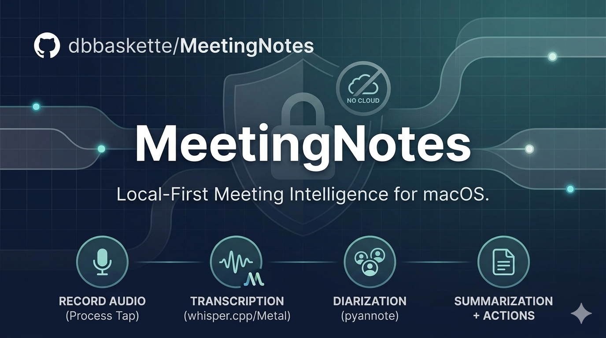
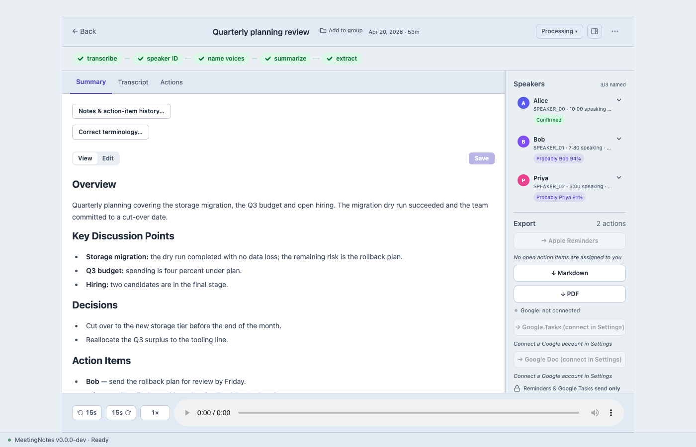
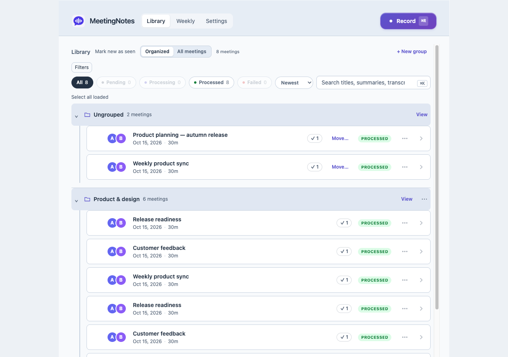
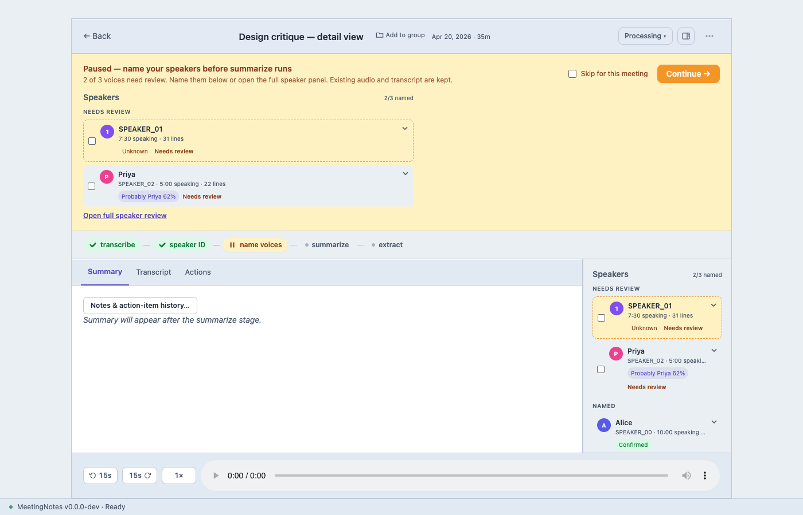
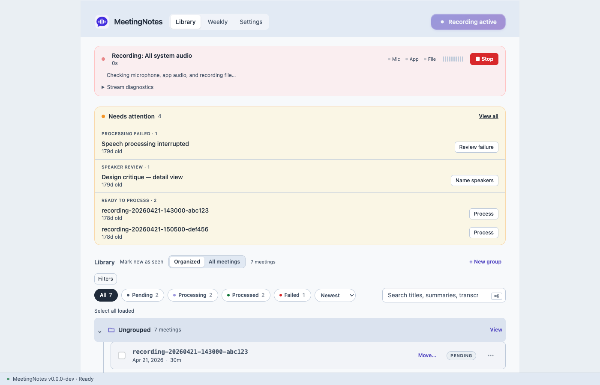
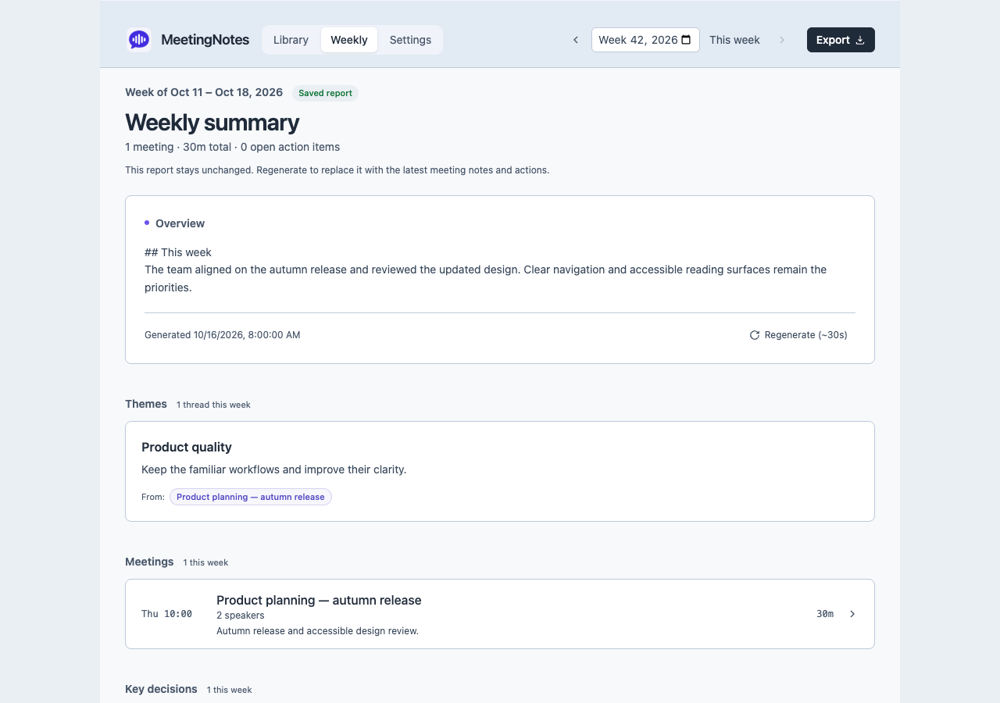
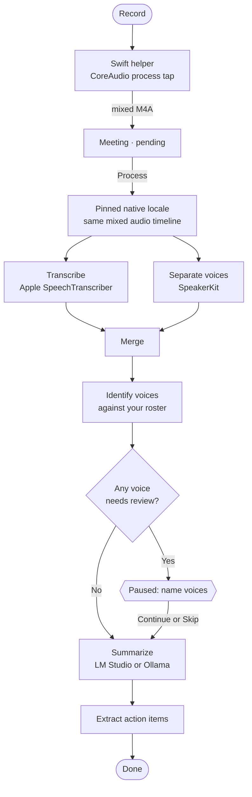

<div align="center">



<h1>MeetingNotes</h1>

<p><strong>Record a meeting on your Mac and get a transcript with named speakers, structured notes and action items, using models that run on your own machine.</strong></p>

[](https://support.apple.com/en-us/HT201260)
[](https://support.apple.com/en-us/HT211814)
[](docs/releases/v1.16.0.md)
[](https://www.electronjs.org/)
[](https://dbbaskette.github.io/MeetingNotes/)

</div>



## What you get

- **Capture without a virtual audio device.** One click records any app's audio (Zoom, Teams, FaceTime, a browser tab) mixed with your microphone, using the macOS 14.2 process tap.
  Microphone timing accounts for delayed buffers; see the [1.14.9 capture fix and playback check](docs/releases/v1.14.9.md).
- **Local transcription with simpler setup.** On Apple Silicon/macOS 26+, Apple SpeechTranscriber transcribes and SpeakerKit OSS separates the voices. This is the only speech engine: no Whisper installation, Python environment, Hugging Face account, token or gated-model approval.
- **A transcript with real names.** Name voices using your existing roster. Confirmed native voice samples power similarity-ranked suggestions in later meetings; you confirm the suggestion before it is applied.
- **Notes you can act on.** A local LLM writes an overview, discussion points, decisions and open questions, then extracts action items with owners and due dates. Each item links back to the line it came from.
- **Notes shaped for your meeting.** Choose General, 1:1, Standup, Customer call, Interview or Decision review templates per group or meeting. Existing notes change only when you explicitly re-run processing.
- **A Library that stays organised.** Groups, search across titles, notes and transcripts, and a **Needs attention** panel for failed runs, voices to name and interrupted recordings. Renames made in meeting details appear when you return, without switching filters or reloading your groups.
- **Uninterrupted processing and recording controls.** Browse one Library scroll area, open an in-progress meeting while other meetings are selected, and queue recordings without a blocking popup. Menu-bar controls and an optional global start/stop shortcut let you manage capture without switching windows.
- **Saved weekly reports.** Themes across the week's meetings, recaps, decisions, and actions, preserved as static snapshots until you explicitly regenerate them.
- **Exports when you want them.** Apple Reminders, Google Tasks, Google Docs, PDF, Markdown, an Obsidian vault, or a webhook.

| Library | Naming voices |
| :---: | :---: |
|  |  |
| **Recording** | **Weekly** |
|  |  |

## Install and first recording

**Required:** Apple Silicon with **macOS 26 or newer**, about 16 GB of RAM recommended, [LM Studio](https://lmstudio.ai) or [Ollama](https://ollama.com) with a chat model, and FFmpeg (`brew install ffmpeg`) for media inspection, sample playback and recovery. Native speech assets need internet for initial setup; inference runs locally after that. Supported languages depend on Apple's assets on your Mac; the initial evaluation used English (en-US).

GitHub releases publish source and release notes without binary installer assets. Build from source, or create a local DMG/ZIP with the [packaging instructions](docs/guide/development.md).

```bash
git clone https://github.com/dbbaskette/MeetingNotes.git
cd MeetingNotes
brew install ffmpeg
./scripts/setup.sh           # source setup; requires Xcode 26+ / macOS 26+ SDK
npm start                    # launch the built source app, or npm run dev
```

Installed apps need no Xcode, Node, Python or Whisper server. Source builds need Node 22 and Xcode 26+ with the macOS 26 SDK. See [Development and packaging](docs/guide/development.md).

On first launch, the three-step setup wizard covers capture permissions, **Prepare native speech**, and the LLM runtime. Speech setup downloads Apple-managed language assets and about **11 MB** of pinned, integrity-verified public SpeakerKit models, without a token. Downloads can be cancelled and retried in **Settings → Processing**. macOS asks for **Microphone** and **Screen & System Audio Recording** the first time you record. Missing speech assets do not prevent recording; prepare them before processing.

1. Click **Record** and pick an app, or **All system audio**.
2. Click **Stop**, then confirm.
3. Open the recording and click **Process**. To skip this step, turn on **Process recordings automatically** in Settings → Processing.
4. If a voice is not recognised, name it and click **Continue**.
5. Read the notes. Edit them, check off action items, or export.

More detail: [Recording](docs/guide/recording.md) · [Working with meetings](docs/guide/meetings.md)

### Upgrading to 1.16.0: what to do

1. Finish recording/processing, quit the app and make a [Library backup](docs/library-backup.md). Install the new regular **MeetingNotes** app when ready; building it does not replace or restart your running app.
2. Open **Settings → Processing** and click **Prepare native speech**. Wait for both language assets and speaker models to be ready. All installations now use Apple + SpeakerKit, regardless of old saved settings.
3. Record/process a new meeting, or explicitly reprocess one old meeting to compare. Existing audio, groups, notes, exports, saved weekly reports and dictionary rules remain in the same library. Upgrading does not regenerate your meetings. Reprocessing preserves the previous transcript in the meeting folder and saves existing notes/tasks to history where applicable; it is not a side-by-side comparison UI.
4. Review the new voices and assign your existing saved people. New diarization labels are run-local: `SPEAKER_00` in a new run is **not** assumed to be the same person as `SPEAKER_00` in an old run. New confirmations teach native profiles; old legacy profiles are retained separately and never mixed with the new model's vectors.
5. Keep your LLM configured for summaries/action items and keep FFmpeg for media tools. Recording, speaker review, shared transcript/summary terminology corrections, notes history, PDF/Markdown exports, groups, Obsidian sync and the rest of the full app remain available.

**What this buys us:** fewer setup steps and accounts, no local Whisper/Python servers or bundled Python/PyTorch payload, on-device Apple transcription with genuine word timing, compact native speaker centroids, and the same full meeting workflow. The helper runs only for its operation, then exits. Whisper management, HF-token setup, remote STT endpoints and the engine selector are removed, not hidden. There is no in-app fallback. Initial Apple language assets and public SpeakerKit downloads still require internet; LLM setup remains separate.

**Voice matching is preserved, not silently converted.** Different models produce incompatible embedding spaces, even at the same vector length. Native profiles are tagged by SDK/model revision and representation. Suggestions show **similarity**, not a confidence percentage, and require confirmation pending broader cross-meeting calibration. Missing/zero vectors leave a voice available for manual naming instead of failing processing.

**Beta users:** the separate **MeetingNotes Beta** comparison workspace is retained, with its copied audio, original transcripts and native profiles. It is not the regular app's live library and its changes are not automatically imported. Use the regular app to process/name voices going forward; keep the beta for side-by-side comparisons. See the [comparison guide](docs/guide/speech-beta.md).

**Limits:** your successful beta evaluation supports this promotion, but synthetic timing tests are not proof of accuracy on every accent, microphone, overlap or noisy meeting. Broad accuracy, peak-memory and held-out identity calibration remain follow-up evaluation work. No universal speed/accuracy advantage over Whisper is claimed. For a regression or unsupported language, quit and reinstall [1.15.0](docs/releases/v1.15.0.md). Keep a backup before reprocessing; rollback cannot undo overwritten outputs. Old Whisper caches, HF credentials and legacy voice profiles are left untouched for rollback, but 1.16 neither reads nor uses them. Native inference requires supported Apple assets; it does not fall back silently or download during processing.

## How it works

MeetingNotes is an Electron app with Swift capture and native speech helpers. Speech runs in a helper per operation and exits afterwards; only the configured summary LLM has a managed server lifecycle.



Transcription and diarization run in parallel. Each meeting is one row in SQLite (`~/Documents/MeetingNotes/db.sqlite`) and one folder of plain files (`transcript.md`, `summary.md`, `action-items.json`) under `meetings/`. If the app quits mid-run, processing resumes on the next launch; a failed meeting waits for **Retry**, which restarts from the last completed stage.

The native language choice is pinned per processing run and retained for crash recovery. Explicit upstream reprocessing starts a new selection. Native raw output retains real word timestamps; the displayed transcript groups those words into speaker turns so searching, phrase corrections and notes generation remain usable. Speaker samples use that same mixed recording timeline.

Native profiles live at `<library>/voice-profiles/`; legacy profiles stay at `<library>/speakers/embeddings/`. Re-downloadable SpeakerKit files live under `~/Library/Application Support/MeetingNotes/speech-models/`; Apple manages its own language assets. See [storage](docs/guide/settings.md).

## Integrations

| Target | What it does |
| --- | --- |
| **Apple Reminders** | Adds your action items to a Reminders list. |
| **Google Tasks / Docs** | Sends action items to Tasks, or the notes to a Doc. Uses your own OAuth client: [setup](docs/google-setup.md). |
| **Markdown / PDF** | Saves the notes as a file, with the action items you select. Generated locally. |
| **[Obsidian](docs/obsidian-sync.md)** | Keeps one Markdown note per finished meeting in a vault folder. One-way. |
| **[Webhook](docs/exporters.md)** | POSTs a `meeting.completed` payload to an HTTPS or localhost endpoint (n8n, Zapier, Slack, Telegram templates). |
| **[URL scheme](docs/url-scheme.md)** | `meetingnotes://record`, `…/stop`, `…/open` for Shortcuts, Stream Deck or scripts. |

## Privacy and security

**What stays on your Mac:** audio, transcripts, notes, the speaker roster and the database. With the default settings, transcription, diarization and summarization all run locally, and the app sends no telemetry and needs no account.

**What can leave, and only if you set it up:**

| You configure | What is sent | Where |
| --- | --- | --- |
| A remote LLM endpoint | Transcript text for notes/action items | That endpoint |
| Google Tasks or Docs export | The items or notes you export | Google |
| A webhook | The meeting payload, per the template and owner filter | Your URL |
| Obsidian sync | Notes written into your vault | Wherever the vault itself syncs |
| Native speech preparation | Public model/language asset download requests; no meeting content or HF token | Apple's asset service and Hugging Face's public model hosting/CDN |

**How the app is hardened:**

- The window runs sandboxed with context isolation and no Node integration. It can only call a fixed API exposed by the preload.
- Every IPC call's arguments are checked against a schema before its handler runs ([`channel-schemas.ts`](electron/main/ipc/channel-schemas.ts)); a test fails if a channel has no schema.
- A Content-Security-Policy denies everything by default and allows only bundled scripts. Links in notes open in your browser and can never navigate the app window.
- The Google refresh token, Google client secret and webhook bearer token are encrypted with the macOS keychain and are never sent to the window. Old HF credentials are not read or modified.
- The `meetingnotes://` URL scheme is treated as untrusted input, and capture is limited to a signed helper that stops if the app exits.

## Documentation

- **Using it:** [Recording](docs/guide/recording.md) · [Working with meetings](docs/guide/meetings.md) · [Models](docs/guide/models.md) · [Settings and storage](docs/guide/settings.md)
- **Integrations:** [Exporters and webhooks](docs/exporters.md) · [Google setup](docs/google-setup.md) · [Obsidian sync](docs/obsidian-sync.md) · [URL scheme](docs/url-scheme.md)
- **Keeping it safe:** [Library backup and restore](docs/library-backup.md) · [Capture and processing reliability](docs/reliable-capture-processing.md)
- **Building it:** [Development and packaging](docs/guide/development.md) · [Local CI](docs/local-ci.md) · [Manual smoke test](docs/manual-smoke-test.md)
- **What changed:** [Release notes](docs/releases/)

Everything is indexed in [docs/README.md](docs/README.md).

## Development

```bash
npm run dev            # Vite + Electron with hot reload
npm run build:speech   # bundled Apple/SpeakerKit Swift helper (Xcode 26+ SDK)
npm test               # full suite, under Electron's Node (no native rebuild)
npm run lint           # whole repository, zero warnings
npm run smoke:source   # build, then launch against a synthetic library
npm run dist           # capture + native speech + app -> local DMG/ZIP
```

CI runs locally in a disposable Tart macOS VM: `bash scripts/ci/tart-macos.sh --quick`. See [Local CI](docs/local-ci.md).

## License

MIT.

## Acknowledgements

- [Argmax SpeakerKit OSS](https://github.com/argmaxinc/argmax-oss-swift) for native speaker diarization and voice embeddings; [SDK/model notices](docs/speech-beta-notices.md)
- Apple SpeechTranscriber for on-device macOS transcription
- [LM Studio](https://lmstudio.ai) and [Ollama](https://ollama.com) for local LLM runtimes
- [AudioCap by @insidegui](https://github.com/insidegui/AudioCap), the process-tap reference that made capture possible
