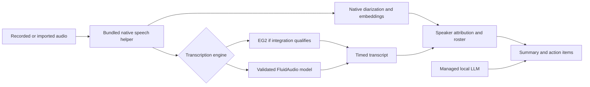

# MeetingNotes: native speech processing and simpler installation

Date: October 12, 2026
Status: Historical proposal, kept for the record. Native speech shipped in 1.16.0 with Apple SpeechTranscriber and SpeakerKit (see `docs/releases/v1.16.0.md`); the EG2 and FluidAudio options evaluated below were not adopted for the shipped app (FluidAudio is used only by the optional Parakeet benchmark adapter).
Code inspected: `b2b36cb` (clean working tree before this document).

## Recommendation

Evaluate Embedding Gemma Transcribe (EG2) as an optional fast English transcription engine. Build the installation improvements around a speech engine bundled with MeetingNotes, automatic model downloads, and a tested default configuration. Evaluate FluidAudio alongside EG2 because it supplies an embeddable Swift runtime and speaker processing as well as transcription.

The first decision is whether EG2's reader, punctuation model, inference implementation, and timestamps are available for supported integration. The public page offers a Mac app, but does not document a CLI, SDK, timestamp export, or redistribution terms for those additional components. Google's base-model license alone does not establish permission to redistribute the complete EG2 transcription system. Keep EG2 integration conditional until this is resolved; do not base installation on controlling another application's UI.

## Evidence and practical limits

- [EG2's project page](https://eg2.haku.sh/) describes a local Neural Engine transcription app for Apple Silicon and macOS 14+, with 715 MB downloaded on first launch. Its author reports 12.6 seconds for an hour of audio on a base M3 Air and roughly 5% word error rate. These are project claims, not MeetingNotes measurements. The described reader selects English words, so treat English as the initial supported scope.
- [Google's model card](https://ai.google.dev/gemma/docs/embeddinggemma/model_card_2) identifies EmbeddingGemma 2 as a multimodal embedding model under Apache 2.0. EG2 adds a trained transcription reader and punctuation stage. Downloading the embedding model alone does not reproduce the app's transcription behavior.
- [FluidAudio](https://github.com/FluidInference/FluidAudio) offers Swift APIs for local transcription, diarization, and speaker embeddings. Its [package manifest](https://github.com/FluidInference/FluidAudio/blob/main/Package.swift) targets macOS 14, although individual models can require newer systems. Select compatible, pinned assets and verify their individual terms and unauthenticated download behavior.
- The [author's X post supplied by the user](https://x.com/tslshahir/status/2109660369429954631) is a research lead. Direct retrieval was unavailable in this session; the technical claims above were checked against the author's accessible project page instead. Any source or weights announced in replies remain unverified.

EG2 addresses transcription. Summaries and action items still need a generative model, and speaker labeling needs a separate diarizer. Moving speech work to native inference may reduce resource competition; it does not itself fix the Gemma reasoning loops diagnosed earlier.

## Current installation friction

| Area | Current implementation | Proposed outcome |
| --- | --- | --- |
| App installation | README instructs users to build from source; public releases omit installers | Download a signed, notarized DMG and drag the app into Applications |
| Transcription | Homebrew `whisper-server`, model download, HTTP service | Bundled native speech helper; models installed inside the app |
| Speaker processing | Bundled Python/PyInstaller service, PyTorch, gated Hugging Face setup | Native diarization and embedding extraction, if quality and asset access qualify |
| Media decoding | Homebrew ffmpeg/ffprobe discovery | Native decoding for supported formats, or bundled licensed tools |
| Summary generation | Separate LM Studio/Ollama installation and model selection | Eventually a bundled runtime with a validated model preset |
| Onboarding | Five steps expose permissions, Whisper, HF, LLM, and STT configuration | Permissions, one download screen, and an explicit sample check |

The Python runtime is already bundled in the packaged app. Removing the sidecar primarily reduces package size and operational complexity; packaged users do not currently need their own Python installation.

## Intended user experience

1. Download and open MeetingNotes.
2. Grant the normal macOS recording permissions.
3. Click **Download recommended models**, with download size, available space, progress, cancellation, and retry visible.
4. Run an explicit short setup check, then record or import audio.
5. Stop recording and watch processing progress; identify unfamiliar voices when needed.
6. Read the transcript and notes. Model and server controls remain available in Advanced settings.

A staged first release can simplify speech processing while retaining the existing summary providers. The final one-app experience requires the separate summary-runtime slice below. Do not advertise a complete dependency-free installation before that slice and media decoding are verified.

## Proposed architecture

Create a separate proposed `speech-engine/` Swift package and `electron/main/speech/` adapter. Keep recording in the existing audio-tap helper. A speech-engine failure must not interrupt capture.

Use a versioned job protocol between Electron and the helper, with progress and a validated final result. Electron owns the child process and passes local file paths without a shell. Support cancellation, bounded execution, parent-exit cleanup, and one lifecycle owner. Normalize engine output into the existing timed transcript and diarization artifacts.

Timestamp output is a requirement: `runTranscribing` emits `{start, end, text}` segments and the merge stage uses their overlap with speaker segments. An EG2 text-only result cannot substitute for this contract. If EG2 lacks usable timing, measure a separate alignment stage and its total cost before selecting it; fabricated timing is unacceptable.

Keep transcription and diarization on the same mixed audio timeline. Benchmark their scheduling on the Neural Engine rather than assuming the current parallel arrangement remains fastest.

## Implementation slices

### 1. Feasibility and engine comparison

**Outcome:** A go/no-go decision for EG2 integration and a measured native baseline.

**Work:** Confirm EG2 code/API availability, trained-reader and punctuation weights, licenses, word or segment timestamps, long-file behavior, and version pinning. Inspect any publicly accessible links in the author's post and replies. Compare current Whisper with EG2 and a macOS-14-compatible FluidAudio model using public licensed speech and synthetic meeting clips. Record cold/warm latency, peak memory, decoding and alignment costs, accuracy, and download footprint. Include names, product terms, negation, dates, numbers, accents, silence, overlap, and 60–90-minute inputs.

**Proposed default-promotion criteria:** At least 2× faster transcription than current Whisper on the same hardware; aggregate WER no more than one percentage point worse; no material loss on critical terms, dates, or negation; valid timestamps and complete long-file output. Publish the benchmark definition before measuring. An engine that misses the quality gate can remain an explicitly selected fast option. No usable interface or unclear redistribution permission means EG2 remains an evaluation candidate while native integration proceeds with the qualified alternative.

**Files:** New benchmark fixtures/scripts under `scripts/ci/`; a recorded comparison under `docs/`. No product defaults change in this slice.

**Verification owner:** Speech implementer. Use synthetic/public inputs first; private meetings are not needed to establish basic feasibility. Real Neural Engine performance requires physical Apple Silicon; a VM pass does not establish speed.

### 2. Bundled native transcription and diarization

**Dependencies:** Slice 1 engine and asset decisions.

**Files:** Proposed `speech-engine/` and `electron/main/speech/`; existing `electron/main/index.ts`, `electron/main/pipeline/context.ts`, `electron/main/pipeline/pipeline.ts`, `electron/main/pipeline/stages/transcribing.ts`, `diarizing.ts`, `identifying.ts`, and `merging.ts`; `electron/main/storage/settings-repo.ts` and `settings-validation.ts`; `electron-builder.yml` and `package.json`.

**Work:** Introduce provider interfaces instead of coupling STT to `LMStudioClient` and diarization to the Python HTTP client. Implement the selected native providers and preserve the current Whisper, pyannote, and external settings for existing installations. Record the provider/model revision with processing artifacts and pin a meeting's active configuration across retries. Validate output bounds, finite times, chronological ordering, input duration, and embedding dimensions. Exercise partial failures and cleanup before enabling the provider in onboarding.

**Speaker migration requirement:** Current roster vectors come from pyannote and carry no model identity. Store new embeddings with model/version identity; never compare or average vectors from different embedding spaces, even if their dimensions match. Preserve existing names and manual links. Re-enroll new-model voice vectors from explicitly selected local samples or confirmation in future meetings, with legacy matching available until migration completes.

**Acceptance:** The native path produces timed, speaker-attributed transcripts, survives helper failure and restart, preserves manual assignments and previous artifacts, and returns users to a recoverable state. Speaker-error rate and roster false matches must be measured against the current pipeline before default promotion. Confirm every selected speech asset can be downloaded on a clean profile without an HF token before promising account-free setup.

**Verification owner:** Speech implementer; targeted protocol, artifact, alignment, and migration tests at the completed slice boundary.

### 3. Downloads, readiness, and onboarding

**Dependencies:** Slice 2 native integration and confirmed model access.

**Files:** `electron/renderer/src/views/OnboardingView.tsx`, `SettingsView.tsx`, `electron/renderer/src/lib/setup-wizard.ts`, `electron/main/ipc/setup-health.ts`, `handlers.ts`, `contracts.ts`, `channel-schemas.ts`, `electron/preload/index.ts`; new model-download code under the proposed speech adapter.

**Work:** Provide one recommended speech configuration, with EG2 offered only where supported and validated. Download pinned assets to an app-owned cache with disk-space checks, cryptographic integrity checks, atomic installation, concurrent-download deduplication, cancellation, and recoverable retry. Reuse the useful streaming/temp-file pattern in `electron/main/whisper/download-model.ts`; actual resume support needs an explicit implementation and tests. Download models independently of app updates.

**Acceptance:** A missing model gives an actionable download control. First-run readiness reflects a completed inference check, rather than mere token presence or HTTP reachability. Downloads interrupted by quit, lost connectivity, corruption, or low disk space never appear installed. Offline inference works after provisioning. Users can record before model downloads finish. Existing installations retain their selected providers; changes apply to subsequent jobs.

**Verification owner:** Onboarding implementer; download fault fixtures and UI readiness/retry coverage at this milestone.

### 4. Complete the one-app setup: media tools and summaries

**Dependencies:** Slices 2–3. This is a separate deliverable from EG2 integration.

**Files:** `electron/main/lib/ensure-wav.ts`, `chunk-wav.ts`, `find-ffmpeg.ts`, library media probing, `electron/main/llm/supervisor.ts`, `electron/main/lm-studio/client.ts`, `electron/main/weekly/prompt.ts`, settings, onboarding, and packaging.

**Work:** Use native audio conversion and duration probing for supported meeting formats, or bundle the required ffmpeg/ffprobe tools after auditing the exact build's licenses. Check every existing media-tool call site before declaring Homebrew unnecessary. Evaluate a pinned bundled [llama.cpp](https://github.com/ggml-org/llama.cpp) runtime with one separately validated, redistributable summary model. Its OpenAI-compatible server can reuse the current chat transport. Preserve LM Studio, Ollama, and external endpoints as advanced choices.

**Reliability:** Use a measured context budget with token headroom and chunked summarization for longer transcripts. Validate thinking-off behavior against actual inference. Bound generation, detect prolonged reasoning without an answer, expose a concise retry action, and release only app-owned models/processes. Do not modify or unload a user's independently managed runtime to free memory.

**Acceptance:** Supported Macs can generate transcripts, notes, action items, and weekly reports with only MeetingNotes installed. Test the earlier thinking-only failure with a disposable fixture; a small canary alone does not prove long-meeting or weekly-report reliability. Select exact summary weights and memory tiers from measured results, rather than making an untested default-model promise.

**Verification owner:** Runtime implementer; media-format, long-context, weekly-output, and lifecycle checks once the end-to-end slice works.

### 5. Installer validation and gradual release

**Dependencies:** Earlier slices accepted for the advertised capabilities.

**Files:** `electron-builder.yml`, `scripts/ci/tart-macos.sh`, `scripts/ci/guest-test.sh`, `scripts/ci/package-runtime.mjs`, `README.md`, `docs/guide/models.md`, `development.md`, and `settings.md`.

**Work:** Package/sign nested native helpers and their required Swift resources. Prepare notarization with existing authorized signing infrastructure. Keep a slim app with first-run model downloads; evaluate an offline package only after distribution rights and size are known. Retain legacy processing through the transition; remove the large Python payload from the default installer only when an explicit compatible fallback/install option exists.

**Acceptance:** A clean user can install from Finder, download models, import synthetic audio, and obtain the promised artifacts without Terminal, Homebrew, Python, an HF account, or another model app. Verify offline reuse, interrupted setup recovery, upgrade behavior, installed-app paths, Gatekeeper/notarization, and actual recording permissions. Compare installer size and time to first usable transcript against today's flow. Promoting native processing for new users requires the preceding quality gates; upgrades do not silently change providers or regenerate old notes.

**Verification owner:** One integration/release owner. Run the full relevant suite once through the existing disposable Tart runner after the integrated code settles, then physical-device Neural Engine/recording acceptance and signed-installer checks. Reuse unchanged evidence. Retain logs with source tree and environment; required remote release gates remain in force. Publication and credential use for a new purpose require separate authorization.

## Scope and review focus

Initial scope is offline batch processing of the current mixed recording timeline. Live captions, independent mic/system transcription, a native UI rewrite, embedding-powered semantic search, automatic reprocessing of the library, and custom model training are subsequent projects.

The highest-risk review points are EG2's integration rights and timestamp support, speaker-vector migration, selected-model OS compatibility, clean-profile download access, helper cleanup, and truthful readiness states. Preserve a working legacy path until each replacement has both correctness and physical-device evidence.

## Next milestone and completion record

Start with slice 1. Its deliverable is a short engine comparison and a supported-integration decision; it should resolve the largest uncertainty before committing to the rest of the build. Later estimates depend on SDK availability, model quality, speaker migration, and signing infrastructure.

- [x] Inspect EG2 public information and current MeetingNotes setup/pipeline.
- [x] Identify native integration options and concrete compatibility gaps.
- [x] Save a proposed plan with milestone verification and rollout gates.
- [ ] Approve implementation scope.
- [ ] Execute feasibility comparison.
- [ ] Implement and verify the approved slices.

No app, model, runtime settings, or installed data were changed while preparing this plan. No installer or models were downloaded or executed.
